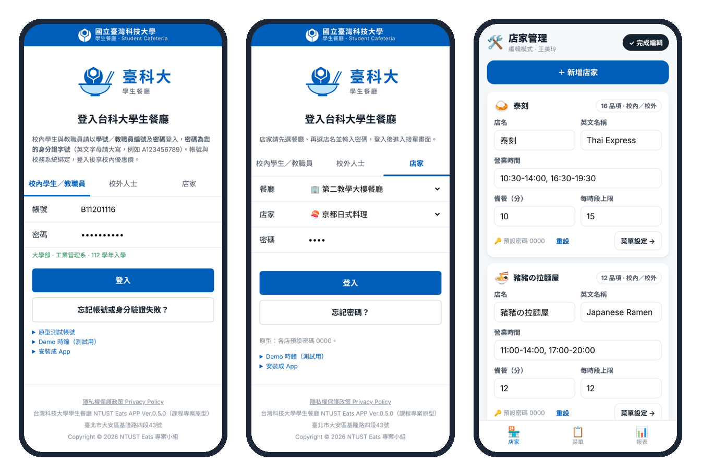
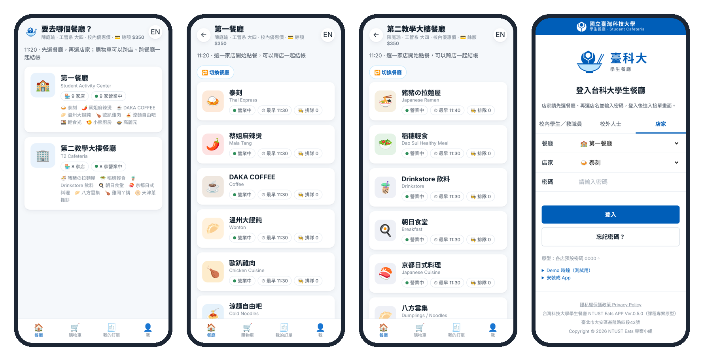
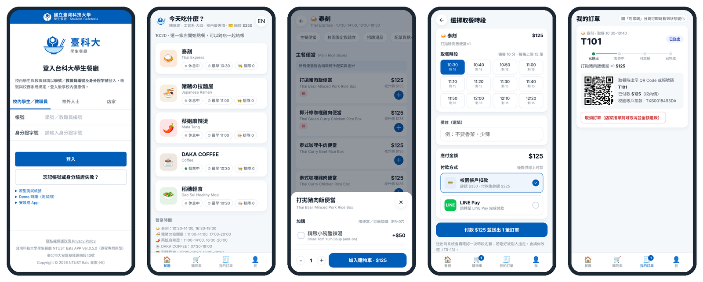
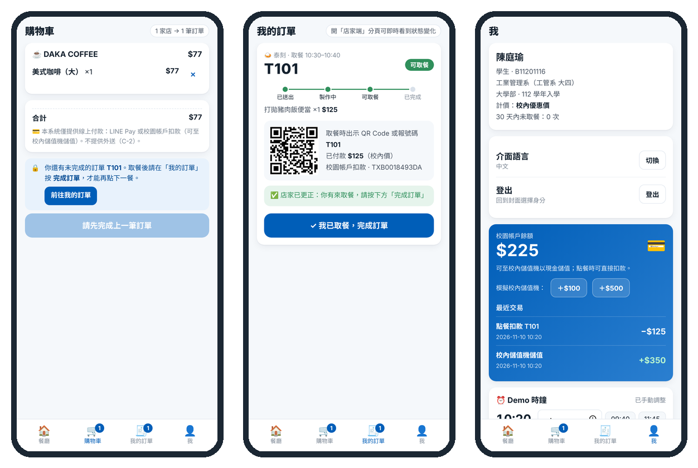
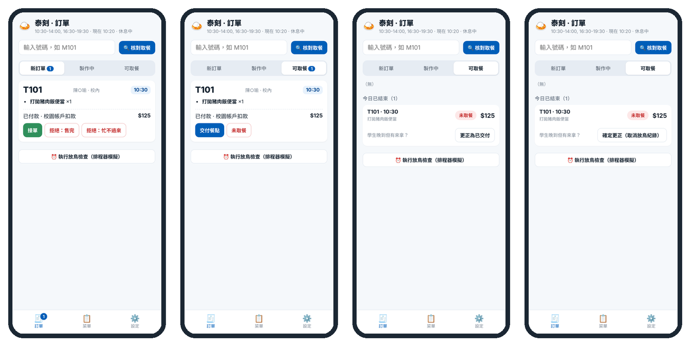
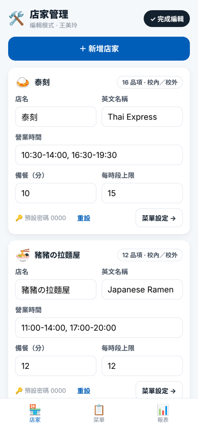
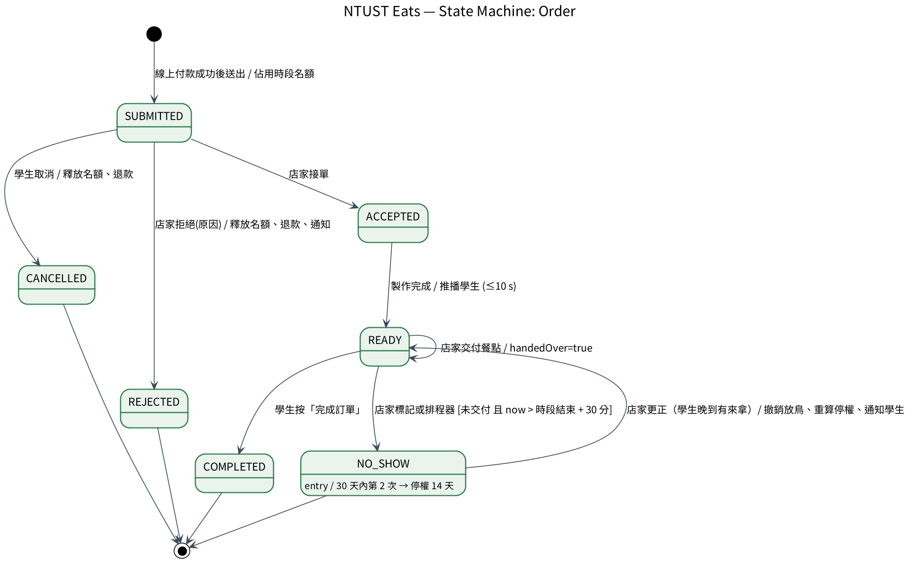

# 台科學餐 NTUST Eats — 台科大學生餐廳線上點餐系統

軟體工程 Midterm Project 2026｜**Waterfall + AI ｜ Agile + AI ｜（加分）AI-Agent Method**｜範圍：至 Requirement Analysis 階段

中午 12:10 下課、1:20 又要上課，泰刻和麻辣燙常排隊 20 分鐘。台科學餐讓師生**上課前先在手機點好、選 10 分鐘一格的取餐時段、線上付款**，下課出示 QR Code 取餐；店家用平板依時段接單。

- 兩個學生餐廳、17 家店、734 道菜（校內價／校外價）。登入後先選餐廳，再選店家：
  - **第一餐廳（學生活動中心）**：泰刻、蔡姐麻辣燙、DAKA COFFEE、溫州大餛飩、歐趴雞肉、涼麵自由吧、輕食光、小熊廚房、高麗元
  - **第二教學大樓餐廳（T2）**：豬豬の拉麵屋、稻穗輕食、Drinkstore 飲料、朝日食堂、京都日式料理、八方雲集、雞同ㄚ講、天津蔥抓餅
- 線上試用：**https://lululu525.github.io/NtustEats/**（手機打開可「加入主畫面」當 App 用）

---

## UI 介紹

### 1. 登入與身分分流

封面先選身分，登入後只看得到自己的功能：

| 身分 | 怎麼登入 | 可以做什麼 |
|---|---|---|
| 校內學生／教職員 | 學號（或教職員編號）＋身分證字號，與校務系統綁定，自動帶出姓名與系級 | 點餐、付款、看訂單 |
| 校外人士 | 免登入，付款時填手機號碼 | 點餐（校外價） |
| 店家 | 先選餐廳、再選自己的店＋密碼 | 接單、交付、售完、時段容量 |
| 總務處 | 用校內身分登入，可切換「編輯模式」 | 新增店家、編輯菜單 |

### 2. 先選餐廳，再選店家

登入後先到「要去哪個餐廳？」，卡片會顯示每個餐廳有幾家店、幾家營業中。選好後只看到那個餐廳的店家，上方可「切換餐廳」。購物車可以跨店、跨餐廳一起結帳。有加購的品項（例如蔥抓餅加配料、飲料加珍珠）會跳出加購選項；看不清楚的價格標「價格待確認」。店家登入也一樣，先選餐廳再選自己的店（最右邊那張）。

### 3. 學生點餐流程

首頁選店 → 選餐點與加購（麻辣燙要選湯底、任選 4 樣火鍋料）→ 跨店放同一個購物車 → 選取餐時段（每格有名額，滿了就不能選）→ 線上付款（LINE Pay 或校園帳戶扣款）→ 拿到訂單號碼與 QR Code。

### 4. 完成訂單與校園帳戶

- 店家「交付」後，學生要自己按 **「完成訂單」**；有未完成的訂單時，不能點下一餐。
- 「我的」頁面看得到校園帳戶餘額與交易紀錄（校內儲值機儲值）。訂單被取消或拒絕會自動退款。

### 5. 店家端

訂單依時段排好：新訂單 → 接單 → 可取餐 → 交付。學生沒來拿可以標「未取餐」；如果學生只是晚到、其實有來拿，可以在「今日已結束」**更正為已交付**（要按兩次確認），系統會撤銷那次放鳥紀錄。

### 6. 總務處編輯模式

### 7. 訂單狀態

### 測試帳號

| 身分 | 帳號 | 密碼／身分證字號 |
|---|---|---|
| 學生（工管系 陳庭瑜） | `B11201116` | `B000000000` |
| 研究生（林家豪） | `M11407021` | `F000000004` |
| 總務處（王美玲） | `T10234` | `A000000009` |
| 店家（任一家） | 下拉選擇 | `0000` |

右下角的「Demo 時鐘」可以調整時間，用來測試 DAKA 早上 10:00 前的優惠和取餐時段。

> 這是**需求原型**，用來給需求方試用、驗證需求；資料只存在瀏覽器裡，沒有真的串金流或校務系統。

---

## 專案文件

文件會隨審查 PR 依序合併進 `main`；合併前可先在最後一個分支 [`feature/noshow-correction`](https://github.com/Lululu525/NtustEats/tree/feature/noshow-correction) 看完整內容。

| 內容 | 位置 |
|---|---|
| 訪談與菜單 | [`docs/interview-notes.md`](https://github.com/Lululu525/NtustEats/blob/feature/noshow-correction/docs/interview-notes.md)、[`data/menu.json`](https://github.com/Lululu525/NtustEats/blob/feature/noshow-correction/data/menu.json) |
| Waterfall + AI | [`SRS.md`](https://github.com/Lululu525/NtustEats/blob/feature/noshow-correction/docs/waterfall/SRS.md)、[`review-log.md`](https://github.com/Lululu525/NtustEats/blob/feature/noshow-correction/docs/waterfall/review-log.md)、審查歷程見 [PR #1～#3](https://github.com/Lululu525/NtustEats/pulls) |
| Agile + AI | [`product-backlog.md`](https://github.com/Lululu525/NtustEats/blob/feature/noshow-correction/docs/agile/product-backlog.md)、User Story 見 [Issues](https://github.com/Lululu525/NtustEats/issues) |
| 需求變更 | [`docs/change-requests/`](https://github.com/Lululu525/NtustEats/tree/feature/noshow-correction/docs/change-requests)（CR-01～09，PR #5～#12 與 #37） |
| UML | [`docs/uml/`](https://github.com/Lululu525/NtustEats/tree/feature/noshow-correction/docs/uml) |
| AI 使用紀錄 | [`docs/ai/`](https://github.com/Lululu525/NtustEats/tree/feature/noshow-correction/docs/ai) |
| 操作手冊（GitHub／Jira） | [`GUIDE-github-jira.md`](https://github.com/Lululu525/NtustEats/blob/feature/noshow-correction/docs/GUIDE-github-jira.md) |

## 組員要做的事

1. 到 [Pull Requests](https://github.com/Lululu525/NtustEats/pulls) 看審查：**每個 PR 要由不是作者的組員按 Approve**，再從 #1 開始依序合併。
2. PO 到 [Issues](https://github.com/Lululu525/NtustEats/issues) 看每個 User Story 的驗收條件，接受的把 `ai-proposed` 換成 `po-accepted`。
3. 開發時 commit 訊息寫 `Refs #<issue 編號>`。

## 規則

- AI 可以起草，只有人可以接受。
- 所有變更都經 Pull Request，由非作者組員 Approve 後合併。
