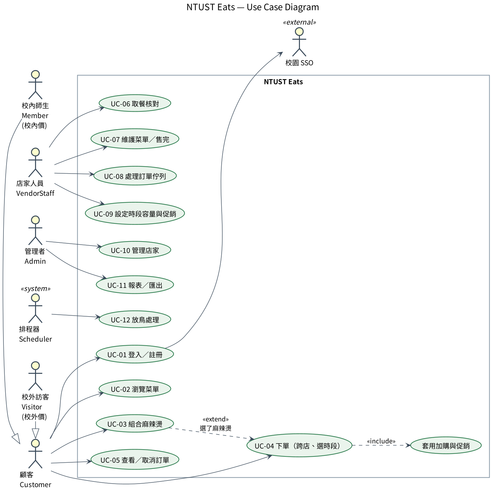
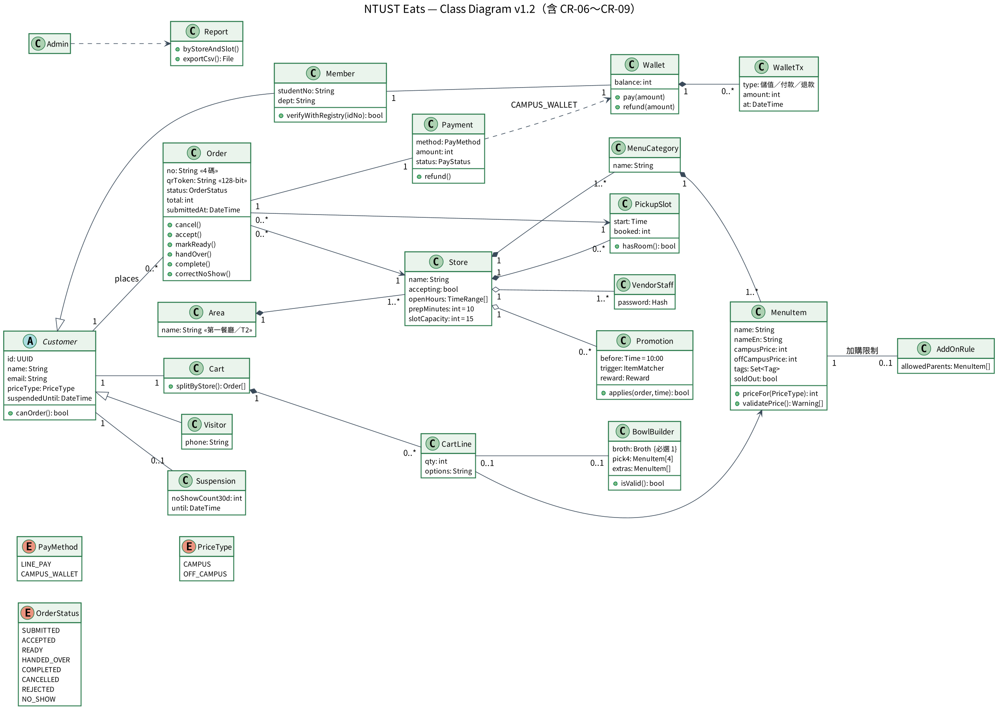
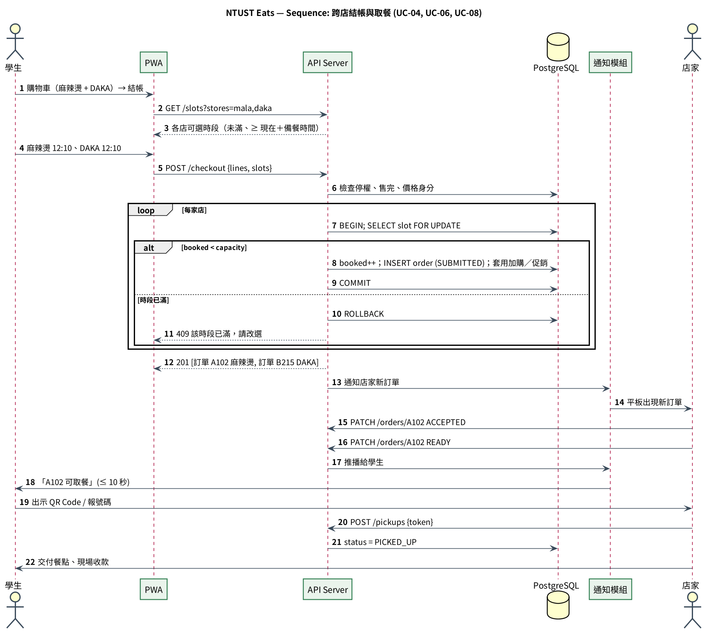
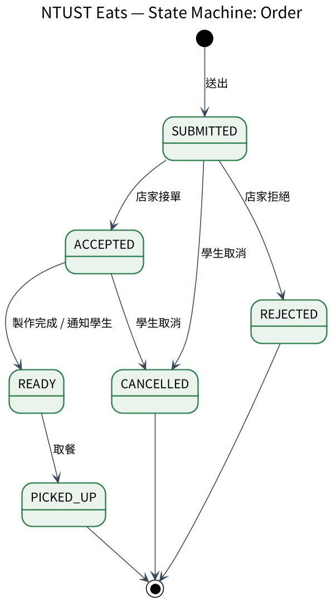
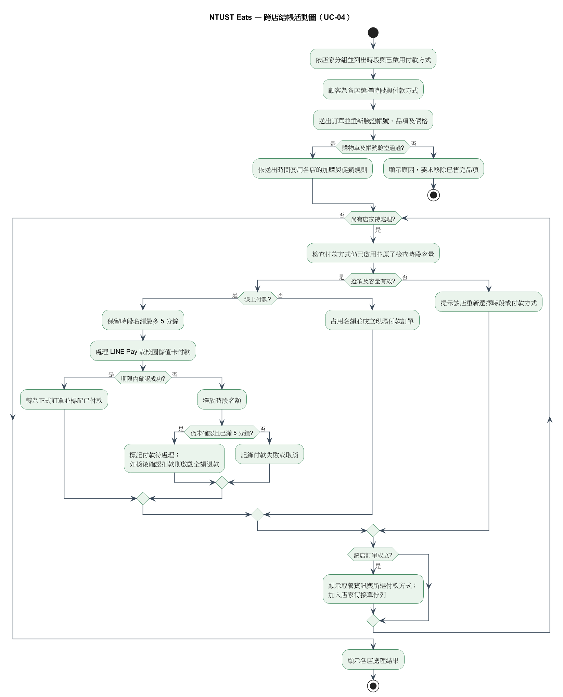
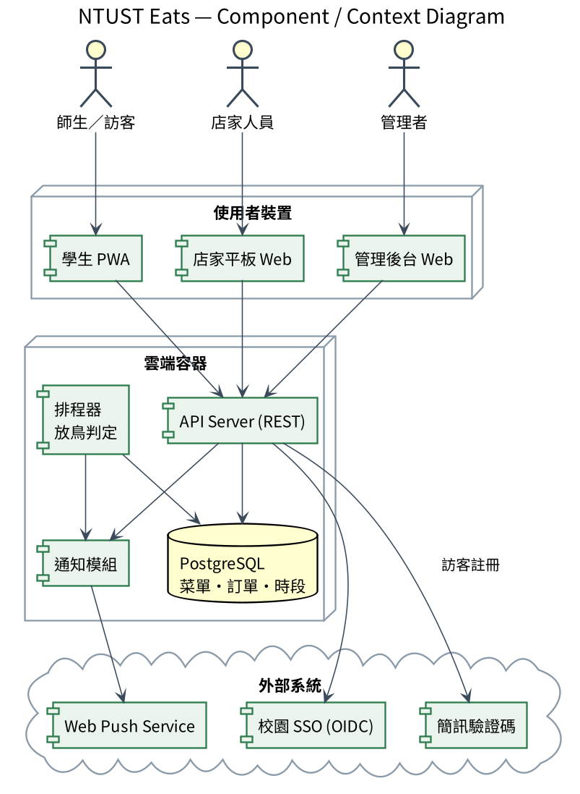
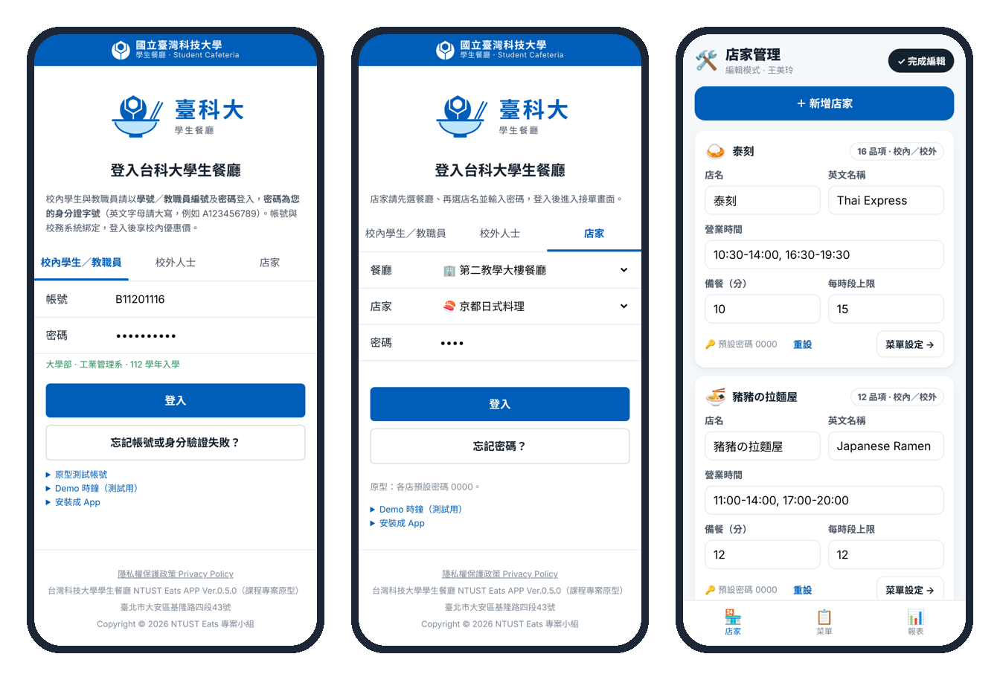
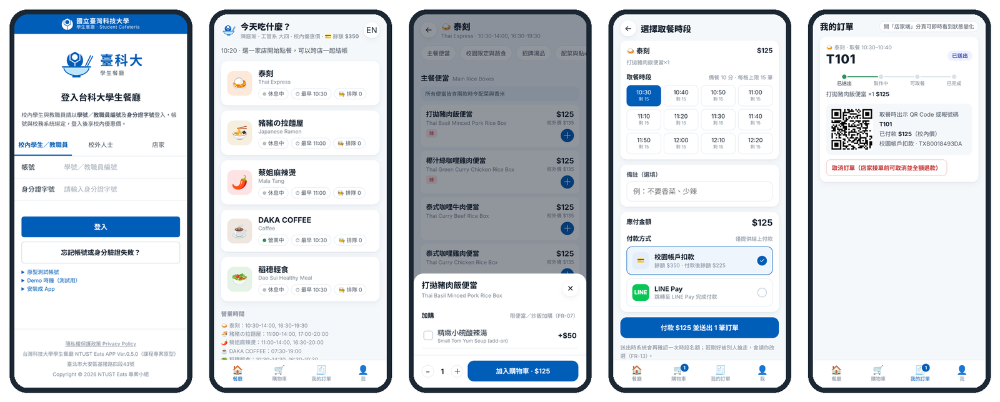
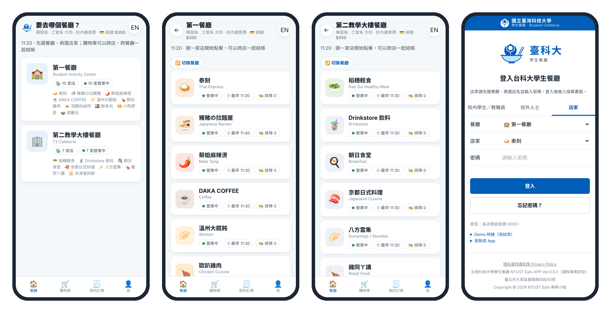

# NTUST Eats 台科大學餐線上點餐系統 — 軟體需求規格書（SRS）

| 文件欄位 | 內容 |
|---|---|
| 開發流程 | Waterfall + AI |
| 版本 | v1.2 — 整合版（本組 SRS v1.1 ＋ SRS v0.1 學妹版的格式與補充需求），待人工審查 |
| 日期 | 2026-11-10 |
| 需求依據 | 訪談紀錄 I-01～I-21；需求蒐集清單 R-01～R-27；兩個學生餐廳 17 家店紙本菜單（734 品項）；需求變更 CR-01～CR-09 |
| 依循標準 | ISO/IEC/IEEE 29148:2018（精簡版） |
| 原型 | https://lululu525.github.io/NtustEats/ |
| 核准狀態 | 尚未核准；v1.0 已簽核，本版待審查（見第 8 節） |

## 1. 緒論（Introduction）

### 1.1 目的
本文件定義 NTUST Eats 校園學餐線上點餐系統的功能、品質需求與限制，作為需求審查、UML 設計與後續驗收的依據，也是 Waterfall 流程中「需求分析」階段的簽核文件。

### 1.2 背景與目標
中午 12:10 下課、13:20 又要上課，熱門店家常需排隊 15～20 分鐘。系統讓師生上課前先在手機選餐、選 10 分鐘一格的取餐時段並線上付款，下課出示 QR Code 取餐；店家依時段接單、更新製作狀態、管理菜單與售完品項；總務處可查看尖峰報表並維護店家資料。

### 1.3 範圍
**範圍內：**校內兩個學生餐廳、共 17 家店：第一餐廳（學生活動中心）9 家：泰刻、蔡姐麻辣燙、DAKA COFFEE、溫州大餛飩、歐趴雞肉、涼麵自由吧、輕食光、小熊廚房、高麗元；第二教學大樓餐廳（T2）8 家：豬豬の拉麵屋、稻穗輕食、Drinkstore 飲料、朝日食堂、京都日式料理、八方雲集、雞同ㄚ講、天津蔥抓餅。涵蓋學生端（含校外人士）、店家端、總務處管理端，以及訂單、付款、退款紀錄的系統處理。使用者與店家登入後都先選餐廳，再選店家。

**範圍外：**外送（I-17）、AI 推薦、會員點數、評分評論、寄杯卡等預付商品（I-21）。需求蒐集表或訪談未列出的功能，不得自動納入。

> v1.0 簽核時範圍為四家店、現場付款；本版依 CR-01（稻穗輕食）、CR-06（線上付款）、CR-09（第一餐廳與 T2 共 12 家店、餐廳分流）更新，變更紀錄見 docs/change-requests/。

### 1.4 用語
| 名詞 | 定義 |
|---|---|
| SRS／FR／NFR／BR | 軟體需求規格書／功能需求／非功能需求／業務規則 |
| 校內價／校外價 | 菜單上的「校內優惠價」與「校外販售價」 |
| 餐廳 | 學生餐廳場地：第一餐廳（學生活動中心）、第二教學大樓餐廳（T2） |
| 取餐時段 | 以 10 分鐘為單位的取餐時間區間，例如 12:10–12:20 |
| 時段容量 | 某店在單一取餐時段最多可接的訂單數 |
| 購物車／訂單 | 購物車可含多家店品項；送出後依店家拆成多筆訂單，每筆屬於一家店 |
| 組合麻辣燙 | 學生自選湯底與食材組成的一碗麻辣燙 |
| 加購 | 必須附屬於某主品項才能購買的品項，例如小碗酸辣湯 |
| 交付／完成 | 店家把餐點交給學生為「交付」；學生在 App 按「完成訂單」後訂單結束 |
| 取餐核銷 | 店家以 QR Code 或訂單號碼確認並交付訂單的操作 |
| 放鳥 | 訂單可取餐後，取餐時段結束 30 分鐘內仍未取餐 |
| 價格待確認 | 菜單照片看不清楚或規則未定的價格，需向需求方確認 |
| 待確認 | 需求來源未明定，需團隊或利害關係人決策（見第 7 節） |

### 1.5 參考文件
- docs/interview-notes.md（I-01～I-21）、data/menu.json
- SRS v0.1（學妹版，需求蒐集清單 R-01～R-27）
- docs/change-requests/CR-01～CR-09
- ISO/IEC/IEEE 29148:2018；《個人資料保護法》；WCAG 2.1；OWASP ASVS 4.0 Level 1

## 2. 整體描述（Overall Description）

### 2.1 使用者與角色
| 角色 | 職責 |
|---|---|
| 校內學生／教職員 | 以學號（教職員編號）＋密碼登入，享校內價；選餐廳與店家、點餐付款、查詢與完成訂單、取消、接收通知 |
| 校外人士 | 免註冊直接點餐，以校外價計；付款時填手機號碼 |
| 店家 | 先選餐廳再選店家登入；查看與處理訂單、更新狀態、核銷取餐、更正未取餐、管理菜單與售完、查看統計 |
| 總務處管理者 | 以教職員帳號登入；切換編輯模式新增店家與菜單、查看報表 |
| 系統（排程） | 記錄訂單、付款與退款；防止時段超收與重複送單；標記放鳥與停權；保存歷史紀錄 |

### 2.2 作業環境
行動優先的 Progressive Web App，可「加入主畫面」當 App 使用。學生端支援 iOS 16+ Safari、Android 12+ Chrome；店家端為 10 吋以上平板；電腦以 Chrome、Edge 操作（NFR-11）。

### 2.3 限制條件
| 編號 | 限制 |
|---|---|
| C-1 | 付款方式限 LINE Pay 與校園帳戶扣款，不處理信用卡（v1.0 原為「不處理線上付款」，依 CR-06 修改，見 Q-01） |
| C-2 | 不提供外送（I-17） |
| C-3 | 個資只儲存學號／手機、姓名、Email；身分證字號只用於比對校務系統，不儲存（I-19） |
| C-4 | 寄杯卡等預付商品不上架（I-21） |

### 2.4 假設與相依性
- A-1 校務系統提供帳號驗證介面，可回傳姓名、系所與身分別。
- A-2 每家店櫃台有一台可連網平板；店家需維護正確的品項、價格與供應狀態。
- A-3 LINE Pay 與校園帳戶提供付款與退款 API；實際串接規格待確認（Q-01）。

## 3. 外部介面需求（External Interfaces）

| 介面 | 需求 |
|---|---|
| 學生介面 | 登入（校內／校外）、選餐廳、店家清單、菜單、購物車、選時段、付款、訂單狀態與 QR Code、歷史訂單、校園帳戶餘額 |
| 店家介面 | 選餐廳＋店家登入、依時段排序的訂單佇列、接單／拒絕、可取餐、交付、未取餐與更正、售完、菜單維護、統計 |
| 管理者介面 | 編輯模式新增店家與菜單、預設密碼重設、報表與 CSV 匯出 |
| 校務系統 | 以學號（教職員編號）與身分證字號比對身分，取得姓名、系所、身分別 |
| 付款介面 | LINE Pay、校園帳戶扣款；付款結果與退款處理 |
| 通知介面 | 訂單可取餐時通知學生：站內通知＋Web Push（Email 用於停權通知） |
| 相機 | 店家端以瀏覽器相機掃描訂單 QR Code |

## 4. 功能需求（Functional Requirements）

來源 I-xx＝訪談紀錄、R-xx＝需求蒐集清單、CR-xx＝需求變更；優先序 M＝Must、S＝Should。FR-01～FR-23 沿用 v1.0 編號；FR-24～FR-28 為本版補充。

### 4.1 帳號與價格身分

**FR-01 校內登入**（優先：M）
- 需求：校內學生與教職員以「學號（或教職員編號）＋密碼」登入，密碼為身分證字號；系統比對校務系統後帶出姓名與系級，所有品項以校內價顯示與計價。
- 驗收條件：輸入正確帳密可登入並顯示「姓名・系級」；學號格式錯誤、密碼格式錯誤、帳密不符各顯示不同錯誤訊息。
- 需求來源：I-07、I-16、R-01、CR-02

**FR-02 校外人士點餐**（優先：M）
- 需求：校外人士不需註冊即可點餐，所有品項以校外價計；付款時須填手機號碼。
- 驗收條件：校外模式全部顯示校外價；未填手機號碼不能送出付款。
- 需求來源：I-16、R-01、CR-06

**FR-03 管理者維護店家**（優先：M）
- 需求：總務處管理者可切換編輯模式，新增店家、設定店家所屬餐廳、營業時段、備餐時間與時段容量，並重設店家密碼。
- 驗收條件：新增的店家立即出現在學生端與店家登入選單中。
- 需求來源：I-15、CR-03

**FR-24 店家登入登出**（優先：M）
- 需求：店家登入時先選餐廳、再選店家並輸入密碼；可登出。
- 驗收條件：店家下拉選單只列出所選餐廳的店；密碼錯誤時保留已選的餐廳與店家。
- 需求來源：R-12、CR-03、CR-09

### 4.2 餐廳與菜單

**FR-04 選餐廳與瀏覽菜單**（優先：M）
- 需求：使用者登入後先選餐廳（第一餐廳／T2），再瀏覽該餐廳各店的菜單分類與品項，可隨時切換餐廳；每個品項顯示中文名、英文名、適用價格、供應狀態與標籤（VEGAN、辣度、校園限定、價格待確認）。
- 驗收條件：第一餐廳顯示 9 家、T2 顯示 8 家；從店家清單可開啟菜單並顯示上述欄位。
- 需求來源：I-03、I-07、I-08、R-02、R-03、CR-09

**FR-05 店家維護菜單與價格**（優先：M）
- 需求：店家可新增、修改、下架自家品項與價格。
- 驗收條件：修改後 1 分鐘內在學生端生效。
- 需求來源：I-15、R-16

**FR-06 售完設定**（優先：M）
- 需求：店家可將品項設為「售完」。
- 驗收條件：學生端 5 秒內顯示售完，且不能加入購物車。
- 需求來源：I-10、R-17

**FR-07 加購品**（優先：M）
- 需求：加購品只能附屬於指定主品項（例如小碗酸辣湯只能附在泰刻便當或炒飯）。
- 驗收條件：主品項移除時，加購品一併移除。
- 需求來源：I-14

**FR-08 組合麻辣燙**（優先：M）
- 需求：必選 1 種湯底；主食、肉類、時蔬、單點火鍋料可複選；「火鍋料任選 4 個」須剛好 4 樣。
- 驗收條件：沒選湯底或任選不是 4 樣時，加入按鈕不能按；總價即時更新。
- 需求來源：I-04、I-14

**FR-09 時段促銷**（優先：S）
- 需求：每日 10:00 前購買 DAKA 美式或鮮奶茶送厚片；熱壓土司送烏瓦紅茶。以訂單送出時間判斷。
- 驗收條件：09:59 送出有贈品、10:00 送出沒有。
- 需求來源：I-14

**FR-10 價格檢查**（優先：S）
- 需求：校外價不得低於校內價；校外價高於校內價 60% 以上且差額 ≥ NT$20 時提示店家確認（不阻擋）。
- 驗收條件：雞排咖哩飯 109／219 會出現黃色提示。
- 需求來源：I-15、I-16

**FR-25 營業狀態**（優先：S）
- 需求：店家可切換「營業中／暫停接單」；暫停時學生不能選該店時段。原型目前依營業時間自動顯示，手動切換尚未實作。
- 驗收條件：切換後學生端顯示「休息中」且不能結帳。
- 需求來源：R-18

### 4.3 點餐與付款

**FR-11 購物車管理**（優先：M）
- 需求：購物車可同時包含多家店、多個餐廳的品項；可修改數量、移除品項；送出時依店家拆成多筆訂單。
- 驗收條件：修改數量或移除後總金額重新計算；兩家店的購物車送出後產生兩個訂單號碼。
- 需求來源：I-03、R-04、R-05

**FR-12 選取餐時段**（優先：M）
- 需求：每筆訂單選一個 10 分鐘取餐時段；最早可選「現在＋該店備餐時間」，且須在營業時間內。
- 驗收條件：過早或超出營業時間的時段不可選。
- 需求來源：I-02

**FR-13 時段容量**（優先：M）
- 需求：每家店每個時段的訂單數不得超過時段容量（預設 15 筆）；已滿的時段不可選；兩人同時搶最後一個名額只能一人成功。
- 驗收條件：並行送出測試 0 筆超收。
- 需求來源：I-09

**FR-14 線上付款與送單**（優先：M）
- 需求：訂單須以 LINE Pay 或校園帳戶付款成功後才送出；成功後顯示訂單號碼、QR Code、店家、時段與金額。校園帳戶顯示付款前後餘額，餘額不足不能選。
- 驗收條件：付款成功才產生訂單號碼；餘額不足時顯示提示。
- 需求來源：I-12、R-06、R-07、R-22、CR-06

**FR-27 防重複送單**（優先：M）
- 需求：同一次送出操作只建立一次訂單與一次扣款。
- 驗收條件：連按兩次送出只產生一筆訂單。
- 需求來源：R-21、R-24

**FR-28 校園帳戶餘額**（優先：S）
- 需求：學生可查看校園帳戶餘額與交易紀錄（儲值、付款、退款）。
- 驗收條件：付款與退款後交易紀錄即時更新。
- 需求來源：CR-06

### 4.4 訂單處理與取餐

**FR-15 訂單狀態**（優先：M）
- 需求：店家依時段排序看到訂單佇列，狀態依序為：已送出 → 已接單 → 可取餐 → 已交付；學生按「完成訂單」後為已完成。學生有未完成的訂單時不能點下一餐。
- 驗收條件：狀態更新後學生端可查詢；有未完成訂單時結帳按鈕停用。
- 需求來源：I-09、I-12、R-13、R-14、R-15、R-25、CR-07

**FR-16 拒絕訂單與退款**（優先：S）
- 需求：店家可拒絕訂單並選擇原因（售完、忙不過來、其他）；已付款訂單自動退款並通知學生。
- 驗收條件：拒絕後學生收到通知，付款金額退回原付款方式。
- 需求來源：I-10、R-23、R-27、CR-06

**FR-17 可取餐通知**（優先：S）
- 需求：訂單變為「可取餐」時通知學生。
- 驗收條件：10 秒內收到站內通知或 Web Push。
- 需求來源：I-05、R-09

**FR-18 取餐核銷**（優先：M）
- 需求：店家以掃描 QR Code 或輸入訂單號碼完成取餐核對並交付。
- 驗收條件：QR Code 與訂單號碼都能找到同一筆訂單；同一訂單不能重複交付。
- 需求來源：I-12、R-20

**FR-26 歷史訂單**（優先：M）
- 需求：學生可查看自己的歷史訂單與每筆狀態。
- 驗收條件：我的訂單頁列出所有訂單與狀態。
- 需求來源：R-08、R-10

### 4.5 取消、放鳥與更正

**FR-19 取消訂單**（優先：M）
- 需求：學生可在店家接單前取消訂單，已付款金額自動退款；接單後不能線上取消。
- 驗收條件：接單前取消成功並退款；接單後取消按鈕不出現。
- 需求來源：I-06、R-11

**FR-20 放鳥標記與更正**（優先：M）
- 需求：訂單可取餐後，取餐時段結束 30 分鐘仍未取餐，標記為「未取餐（放鳥）」。店家若誤標，可經兩段確認更正為已交付，系統撤銷放鳥並重算停權、通知學生。
- 驗收條件：更正後該筆不計入放鳥次數，歷程記錄 NO_SHOW_CORRECTED。
- 需求來源：I-13、CR-08

**FR-21 放鳥停權**（優先：M）
- 需求：同一帳號 30 天內放鳥 2 次，暫停線上點餐 14 天，並以 Email 通知。
- 驗收條件：第 2 次放鳥後無法結帳，顯示停權到期日。
- 需求來源：I-13

### 4.6 管理與報表

**FR-22 報表**（優先：M）
- 需求：管理者可依店家、日期、每 10 分鐘時段檢視訂單數、取消數、放鳥數；店家可看自家當日統計。
- 驗收條件：報表數字與訂單紀錄一致。
- 需求來源：I-18、R-19、R-26

**FR-23 匯出 CSV**（優先：M）
- 需求：管理者可將報表匯出為 CSV。
- 驗收條件：匯出檔可用 Excel 開啟。
- 需求來源：I-18

### 4.7 主要訂單流程
登入（校內／校外）→ 選餐廳 → 選店家與菜單 → 購物車（可跨店、跨餐廳）→ 每家店選取餐時段 → 線上付款（LINE Pay／校園帳戶）→ 店家接單 → 可取餐通知 → 出示 QR Code，店家交付 → 學生按「完成訂單」。

> 學妹版 4.3 提出的「付款與接單的先後」「拒單退款時機」「狀態名稱統一」已依 CR-06、CR-07 決定：先付款再送單；拒單或接單前取消自動退款；狀態名稱以 FR-15 為準。

## 5. 非功能需求（Non-Functional Requirements）

| 編號 | 類別 | 規格 | 驗收方式 | 來源 |
|---|---|---|---|---|
| NFR-01 | 效能 | 800 位同時在線使用者下，菜單頁回應時間 p95 ≤ 1 秒 | 負載測試 | I-20 |
| NFR-02 | 效能 | 送出訂單 p95 ≤ 1.5 秒，且時段 0 筆超收 | 並行測試 | I-09 |
| NFR-03 | 可用性 | 10:30–14:00 與 16:30–20:00 服務可用率 ≥ 99.5% | 監控紀錄 | I-20 |
| NFR-04 | 易用性 | 學生從開啟 App 到送出一筆單店訂單，中位數 ≤ 60 秒 | 5 人可用性測試 | I-01、I-02、R-03 |
| NFR-05 | 易用性 | 介面提供繁體中文與英文；色彩對比符合 WCAG 2.1 AA | 對比檢測工具 | I-07 |
| NFR-06 | 安全 | 全站 HTTPS；訂單 QR Code 為 ≥ 128 bits 隨機值；通過 OWASP ASVS Level 1 | 弱點掃描 | I-12 |
| NFR-07 | 隱私 | 只儲存學號／手機、姓名、Email；身分證字號不儲存；店家端姓名遮罩；訂單個資保存 1 年後去識別化 | 資料庫檢查 | I-19 |
| NFR-08 | 可維護性 | 時段容量、備餐時間、促銷規則、放鳥門檻、店家與餐廳皆可設定，不需改程式 | 管理介面操作 | I-14、I-15 |
| NFR-09 | 授權 | 學生不能修改店家訂單狀態；店家只能管理自己店的訂單與菜單 | 以不同身分測試未授權操作被拒絕 | R-13、學妹版 NFR-02 |
| NFR-10 | 可靠性 | 成功送出的訂單與付款紀錄必須正確保存，不遺失、不重複 | 重複提交與斷線測試 | R-21、R-24 |
| NFR-11 | 相容性 | 學生端支援 iOS Safari、Android Chrome；電腦支援 Chrome、Edge；店家端支援平板 | 指定裝置跑主要流程 E2E 測試 | 學妹版 NFR-05 |

## 6. 業務規則與需求追溯（Business Rules & Traceability）

### 6.1 業務規則
| 規則 | 內容 | 相關需求 |
|---|---|---|
| BR-01 | 價格依身分：校內師生＝校內價；校外人士＝校外價 | FR-01、FR-02 |
| BR-02 | 取餐時段 10 分鐘一格；每店每格預設 15 筆 | FR-12、FR-13 |
| BR-03 | 火鍋料任選 4 個 = 一組，校內 25／校外 30 | FR-08 |
| BR-04 | 小碗酸辣湯 50 元，限附屬於泰刻便當或炒飯 | FR-07 |
| BR-05 | DAKA 10:00 前：美式／鮮奶茶送厚片；熱壓土司送烏瓦紅茶 | FR-09 |
| BR-06 | 接單前可取消並退款；30 天放鳥 2 次 → 停權 14 天；店家誤標可更正 | FR-19～FR-21 |
| BR-07 | Drinkstore 菜單為原價，校內價＝原價 × 0.9 四捨五入 | FR-04 |
| BR-08 | 雞同ㄚ講校外價＝校內價 + 10；八方雲集麵食套餐不分校內外 | FR-04、BR-01 |
| BR-09 | 八方雲集鍋貼、水餃以 10 顆為一份計價 | FR-04 |
| BR-10 | 送單成功才建立訂單編號；售完品項不可訂購；店家只管理自己的訂單 | FR-06、FR-14、NFR-09 |
| BR-11 | 訂單交付後才能由學生完成；有未完成訂單時不能點下一餐 | FR-15 |

### 6.2 需求追溯矩陣
| 需求 | 來源 | Use Case | User Story | UML 元素 | 驗證方式 |
|---|---|---|---|---|---|
| FR-01 | I-07、I-16、CR-02 | UC-01 登入 | US-01、US-18 | Class: Member | 整合測試 |
| FR-02 | I-16、CR-06 | UC-01 | US-02 | Class: Visitor | 功能測試 |
| FR-03 | I-15、CR-03 | UC-10 管理店家 | US-16、US-19 | Class: Store | 功能測試 |
| FR-04 | I-03、I-07、CR-09 | UC-02 瀏覽菜單 | US-03、US-25 | Class: MenuItem、Area | 功能測試 |
| FR-05 | I-15 | UC-07 維護菜單 | US-15 | Class: MenuItem | 功能測試 |
| FR-06 | I-10 | UC-07 | US-10 | MenuItem.soldOut | 計時測試 |
| FR-07 | I-14 | UC-04 下單 | US-05 | Class: AddOnRule | 功能測試 |
| FR-08 | I-04、I-14 | UC-03 組合麻辣燙 | US-04 | Class: BowlBuilder | 邊界值測試 |
| FR-09 | I-14 | UC-04 | US-13 | Class: Promotion | 邊界值測試 |
| FR-10 | I-15、I-16 | UC-07 | US-15 | MenuItem.validatePrice() | 邊界值測試 |
| FR-11 | I-03、R-04 | UC-04 | US-06 | Seq: checkout（拆單） | 功能測試 |
| FR-12 | I-02 | UC-04 | US-07 | Class: PickupSlot | 邊界值測試 |
| FR-13 | I-09 | UC-04 | US-07 | Seq: checkout（鎖定） | 並行測試 |
| FR-14 | I-12、CR-06 | UC-04、UC-05 | US-08、US-22 | Class: Order、Payment | 功能測試 |
| FR-15 | I-09、CR-07 | UC-08 處理訂單 | US-09、US-23 | State: Order | 功能測試 |
| FR-16 | I-10、R-23 | UC-08 | US-09、US-22 | State: REJECTED | 功能測試 |
| FR-17 | I-05 | UC-08 | US-12 | Class: Notification | 計時測試 |
| FR-18 | I-12 | UC-06 取餐 | US-09 | Seq: pickup | 功能測試 |
| FR-19 | I-06 | UC-05 | US-11 | State: CANCELLED | 功能測試 |
| FR-20 | I-13、CR-08 | UC-12 放鳥處理 | US-14、US-24 | State: NO_SHOW | 排程測試 |
| FR-21 | I-13 | UC-12 | US-14 | Class: Suspension | 邊界值測試 |
| FR-22 | I-18 | UC-11 報表 | US-16 | Class: Report | 功能測試 |
| FR-23 | I-18 | UC-11 | US-16 | — | 功能測試 |
| FR-24 | R-12、CR-09 | UC-08 | US-19、US-25 | Class: VendorStaff | 功能測試 |
| FR-25 | R-18 | UC-07 | （待建立） | Store.accepting | 功能測試 |
| FR-26 | R-08、R-10 | UC-05 | US-08 | Class: Order | 功能測試 |
| FR-27 | R-21、R-24 | UC-04 | US-06 | Seq: checkout（冪等） | 重複提交測試 |
| FR-28 | CR-06 | UC-05 | US-22 | Class: Wallet | 功能測試 |

## 7. AI 使用紀錄與待審查事項（AI Usage & Review）

**AI 參與：**AI 依訪談紀錄、需求蒐集清單與菜單照片起草各章節、補充驗收條件、把紙本菜單轉成資料，並比對 SRS 與需求變更找出衝突。AI 產生的內容一律標為草稿，須經組員審查（PR Approve）才能納入；第 7.1 節記錄每一版由誰批准。

### 7.1 待確認事項
| 議題 | 問題 | 建議動作 | 狀態 |
|---|---|---|---|
| Q-01 | 線上付款（CR-06）與訪談 I-11「店家不想處理金流」衝突；付款平台規格未定 | 回訪店家確認；確定 LINE Pay／校園帳戶 API | 待確認 |
| Q-02 | 密碼使用身分證字號屬敏感個資（NFR-07、C-3） | 評估改用校園 SSO 或首次登入改密碼 | 待確認 |
| Q-03 | 店家預設密碼 0000 不符 NFR-06 | 首次登入是否強制改密碼 | 待確認 |
| Q-04 | 拒單／取消的退款時限、手續費與失敗處理 | 定義退款規則 | 待確認 |
| Q-05 | 店家可自行更正放鳥，可能被濫用 | 是否需總務處審核、更正期限 | 待確認 |
| Q-06 | 通知媒介與即時性標準（站內、推播、Email） | 決定媒介與送達標準 | 部分決定（FR-17） |
| Q-07 | 價格待確認：溫州大餛飩、歐趴雞肉、涼麵自由吧、輕食光部分品項；雞同ㄚ講烤雞腿／油雞腿校外價 | 向店家確認後修正 menu.json | 待確認 |
| Q-08 | 新增 12 家店的營業時間、ramen／稻穗所屬餐廳 | 向店家確認 | 待確認 |
| Q-09 | 營業狀態手動切換（FR-25）尚未實作 | PO 決定是否排入下個 Sprint | 待確認 |
| Q-10 | 付款與接單的先後、狀態名稱不一致（學妹版 Q-02、Q-07） | 已依 CR-06、CR-07 決定，見 FR-14、FR-15 | 已解決 |
| Q-11 | 店家能否接受／拒絕訂單（學妹版 Q-06、FR-18） | 已納入 FR-15、FR-16 | 已解決 |
| Q-12 | 取餐核銷憑證（學妹版 Q-08） | QR Code 或訂單號碼（FR-18） | 已解決 |

### 7.2 審查版本紀錄
| 版本 | 工作 | GitHub 證據 | 批准者 | 狀態 |
|---|---|---|---|---|
| v0.1 | AI 依訪談與菜單產生初稿 | 初始 commit | （草稿，未批准） | 完成 |
| v0.2 | 釐清模糊需求（7 項不可量測字詞） | PR #1／Review／Merge | 【組員姓名】 | 待合併 |
| v0.3 | 補上遺漏需求（訪談 × 需求對照） | PR #2／Review／Merge | 【組員姓名】 | 待合併 |
| v0.4 | 移除 AI 自行加入的需求（付款、外送、推薦） | PR #3／Review／Merge | 【組員姓名】 | 待合併 |
| v1.0 | 全體簽核，進入設計 | PR #5 | 全體 | 待合併 |
| v1.1 | 依 CR-01～CR-09 回寫範圍：17 家店、餐廳分流、線上付款 | PR #37 | 【組員姓名】 | 待合併 |
| v1.2 | 整合學妹版 SRS v0.1 的格式與 R-01～R-27 補充需求（FR-24～FR-28、NFR-09～11、Q 表） | （本次 commit） | 【組員姓名】 | 待審查 |

詳細審查發現見 `docs/waterfall/review-log.md`。

## 8. 簽核（Sign-off）

> 依 Waterfall + AI 規則：AI 可以起草，只有人可以接受。下列人員簽核後本文件凍結，方可進入設計階段。

| 欄位 | 內容 |
|---|---|
| 文件版本 | v1.2 |
| 文件狀態 | 待審查 |
| 審查人員 | 【填入】 |
| 核准人員 | 【填入】 |
| 核准日期 | 【填入】 |
| 核准結果 | 尚未核准 |

| 角色 | 姓名 | 日期 | 簽核 |
|---|---|---|---|
| 需求分析負責人 | 【填入】 | 【填入】 | ☐ |
| 審查者 1 | 【填入】 | 【填入】 | ☐ |
| 審查者 2 | 【填入】 | 【填入】 | ☐ |

## 附錄 B. 圖

## 附錄 A. UML 圖

| 圖 | 檔案 |
|---|---|
| Use Case Diagram | `docs/uml/png/01_use_case.png` |
| Class Diagram v1.2 | `docs/uml/png/09_class_v1_2.png` |
| Class Diagram v1.0 | `docs/uml/png/02_class.png` |
| Sequence：跨店結帳與取餐 | `docs/uml/png/03_sequence_checkout_pickup.png` |
| State Machine：Order | `docs/uml/png/04_state_order.png` |
| Activity：結帳與選時段 | `docs/uml/png/05_activity_checkout.png` |
| Component：系統脈絡 | `docs/uml/png/06_component.png` |

PlantUML 原始碼位於 `docs/uml/src/`；可操作原型：https://lululu525.github.io/NtustEats/
